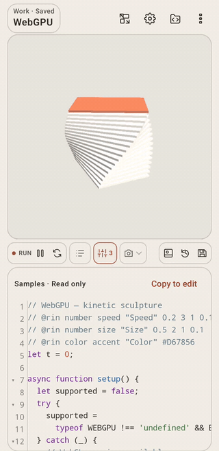

# Edit:RiN

**Edit:RiN** is a mobile creative coding environment and p5.js editor designed for Android. Create, sketch, and experiment with generative art anywhere, directly on your device.

[Official website](https://rin-code-dev.github.io/Edit-RiN/) · [日本語の案内はこちら](#日本語) · [Download](https://github.com/rin-code-dev/Edit-RiN/releases) · [Changelog](CHANGELOG.md) · [Issues](https://github.com/rin-code-dev/Edit-RiN/issues)

<p align="center">
  <a href="https://rin-code-dev.github.io/Edit-RiN/">
    
  </a>
</p>

---

## Features

- **Live Code Editing & Preview**: Interactive p5.js canvas with split-view and fullscreen mode.
- **Live Parameters**: Tweak variables on the fly with dynamic sliders and color pickers generated directly from code comments.
- **Multiple p5.js Runtimes**: Switch between **p5.js 2.3.4** (modern, async setup) and **p5.js 1.11.5** (classic compatibility) per work.
- **HTML & Modules**: Edit HTML/CSS and nested project files; run ES modules, instance sketches, and multiple canvases. Add HTTPS libraries in Runtime settings.
- **Browser Features**: Camera/microphone permissions, sketch file pickers, native file downloads, and sketch fullscreen.
- **Device Motion & Orientation**: Native tilt and motion sensors (`rotationX`/`Y`/`Z`, `accelerationX`/`Y`/`Z`, and `deviceShaken()`) for mobile-first interactive artworks.
- **Audio & Sound**: Built-in support for `p5.sound` for audio synthesis, playback, and FFT analysis.
- **Work & Asset Management**:
  - Store multiple works with revision history and ZIP backup/export.
  - Per-work asset support (images, audio, video, fonts, JSON/CSV) with instant loading-code insertion.
  - Single-work ZIP export and import for easy sharing.
  - Import public sketches directly from your p5.js Web Editor account.
- **Sharing**: Create share-card images with artwork, a code excerpt, and an optional QR code linking to a URL you choose. Share saved images and recordings through Android. The former Web Player has been retired; QR codes do not upload or host sketches.
- **Capture & Export**: Record animations (video/GIF) and capture high-resolution screenshots.
- **Customizable Environment**: Custom editor themes, fonts (TTF/OTF/TTC), ligature support, and canvas orientation toggle.
- **Multilingual Support**: Fully localized in English, Japanese (日本語), and Simplified Chinese (简体中文).
- **Privacy First**: Edit and run works with bundled libraries and local assets offline. Updates, public-sketch imports, and external resources require a network connection. No ads, trackers, or analytics.

---

## Live Parameters

Add `@rin` annotations to your JavaScript code to automatically create interactive controls in the preview panel. Values update in real time via the `rinParams` object and are saved with your sketch:

```javascript
// @rin number speed "Speed" 0 3 1 0.1
// @rin number strokeSize "Stroke size" 1 16 4 1
// @rin color ink "Color" #BA90E2

function setup() {
  createCanvas(400, 400);
}

function draw() {
  background(20);
  stroke(rinParams.ink);
  strokeWeight(rinParams.strokeSize);
  circle(width / 2, height / 2, 80 + sin(frameCount * 0.02 * rinParams.speed) * 40);
}
```

### Editing and preview in v4.2.0

- **Parameter Presets, Morphing & 2D XY Pad**: Save and switch parameter presets with 650 ms smooth morphing or an A↔B blend slider, declare 2-axis controls via `@rin xy` / `@xy`, and tune parameters fullscreen in portrait alongside a floating PiP preview.
- **Cross-Work Code Search & Custom Covers**: Search source files across works directly from the gallery with `file:line` jumps, and pin or reset custom preview thumbnails from any frame.
- **Inspection, REPL & Loop Recording**: Toggle a live FPS/`frameCount`/resolution HUD, step frame by frame (`+1`), evaluate expressions in a console REPL with history, and export frame-synced 30 fps GIFs or timed loop recordings.
- **Shaders, Completions, Outline & Block Upgrades**: GLSL syntax highlighting (`.frag`, `.vert`, `.glsl`, `.wgsl`), expanded p5/`p5.brush`/Matter/GLSL completions, Code Outline jump, Block Mode whole-code highlight with auto-scroll, and bundled `parameters`/`p5.brush`/`matter-js` block templates.
- **Performance Architecture & UI Fixes**: Async-cached gallery thumbnail flags, draw/layer-phase gallery transitions, kept-alive workspace under Settings, reduced `BoxWithConstraints` overhead, per-card parameter skipping, and responsive wrapped fullscreen preview controls.
- **Redesigned Landscape Workspace & Gallery**: Evenly spaced vertical tool rail, balanced 50/50 editor and 1:1 preview layout, and a minimal collapsible sidebar with 1:1 square artwork thumbnails and uniform horizontal sample cards.
- **Floating Unit Modals & Unified Controls**: Menus, inspectors, and dialogs appear as bordered floating Units in both portrait and landscape, with crisp light-mode contrast, unified rounded-square control shapes, and consistent touch highlights.
- **Compact Portrait Editor Overlay**: Floating top-right mode/file capsule hides redundant `sketch.js` labels on single-file works and auto-hides while typing to maximize code space.
- Switch between Code Mode and Block Mode while keeping `sketch.js` as the single source of truth. In Block Mode, adjust color and number capsules directly, insert blocks from the bottom dock, and jump between functions.
- Browse auto-save history and named snapshots in a unified sheet with restoration scope indicators and code comparison.
- Use a floating preview while editing in portrait orientation. Change its size, move it between corners, or minimize it.
- Generate controls from inline comments such as `let speed = 1; // @slider(0, 3, 0.1)`. Controls update parameter values and the matching code; `@rin` declarations remain supported.
- Add `// ?` to a supported expression or assignment to display its value beside the code while it runs.
- Enable Auto-Run to rerun after typing pauses. Normal code reruns and asset changes reload the preview; animation and audio state may restart.
- Use the 140/280-character counter and code compression tools for short sketches. Check the compressed sketch before sharing it.
- Export a single HTML file for browser playback. Bundled libraries resolve to public CDNs, and local script and stylesheet tags are safely inlined without corrupting embedded code, external URLs, or comments. Use a work ZIP when transferring the complete project.
- Replay the introductory tour or editor practice tour from Settings.

---

## Installation & Requirements

- **Supported OS**: Android 11 (API level 30) or later for the current v4.2.0 release. Older v2.3.1 supports Android 6.0 or later.
- **Download**: Get the latest signed APK from [GitHub Releases](https://github.com/rin-code-dev/Edit-RiN/releases).
- **Updates**: Starting with the v2.3.0 release app, download future updates within the app, then install through Android’s confirmation screen. Download progress and cancellation are available.

---

## Building from Source

### Prerequisites
- JDK 25 (Java toolchain)
- Android SDK matching `compileSdkVersion` in [android/variables.gradle](android/variables.gradle) (currently API 37)
- Gradle via the included wrapper (currently 9.8.1); no separate Gradle installation is needed
- Android Gradle Plugin 9.4.1, Kotlin / Compose compiler 2.4.21, and SDK Build Tools 37.0.0 (configured by the project)

### Build Commands
```sh
./scripts/build-apk.sh debug
# Include Android unit tests:
./scripts/build-apk.sh debug --test
```

For signed release builds and configuration, refer to [RELEASE.md](RELEASE.md).
For source ownership, runtime flow, generated files, and focused checks, see
[Development guide / 保守ガイド](docs/DEVELOPMENT.md).

---

## Documentation

- [Development Guide (保守ガイド)](docs/DEVELOPMENT.md): Source map, state ownership, and validation commands.
- [Asset Guide (素材ガイド)](ASSETS.md): Managing images, audio, fonts, and data files.
- [p5.js Runtime & Sound](P5_RUNTIME_AND_SOUND.md): Runtime versions and audio setup.
- [p5.js Compatibility](P5_COMPATIBILITY.md): HTML/modules, browser features, configuration, and limits.
- [Language Support](LANGUAGE_SUPPORT.md): Localization details and supported languages.
- [Changelog](CHANGELOG.md): Release history and notes.
- [Contributing](CONTRIBUTING.md): Issues, feedback, and contribution guidelines.
- [Privacy Policy](PRIVACY.md): Data privacy and network behavior.
- [Third-Party Notices](THIRD_PARTY_LICENSES.md): Open-source licenses and acknowledgments.

---

## 日本語

Edit:RiN は、Android 端末で p5.js のコードを書き、ジェネラティブアートやクリエイティブ・コーディングを楽しめるエディタアプリです。

[公式サイト](https://rin-code-dev.github.io/Edit-RiN/)で、アプリの紹介と操作動画をご覧いただけます。サイトは英語で表示されます。

### 主な機能

- ライブプレビュー：コードを書きながら、その場で動作を確認できます。全画面表示、MP4・GIFの録画、高解像度のスクリーンショットに対応しています。
- ライブパラメータ：コードに `// @rin number ...` や `// @rin color ...` と注釈を書くと、スライダーやカラーピッカーが表示されます。値を調整すると、作品にその場で反映されます。
- 端末センサー：端末の傾きや加速度を取得し、端末を動かして操作する作品を作れます。`rotationX`/`Y`/`Z`、`accelerationX`/`Y`/`Z`、`deviceShaken()` などを使えます。
- 実行環境の切り替え：作品ごとに `p5.js 2.3.4` と `1.11.5` を選べます。`p5.sound` による音の再生・合成・解析にも対応しています。
- 素材の管理：画像・音声・フォント・JSON などを作品に取り込み、タップして読み込みコードを挿入できます。作品ごとに ZIP を書き出したり、取り込んだりして共有できます。
- 作品の共有：作品画像・コードの抜粋・指定したURLのQRコードを組み合わせたシェアカードを作れます。保存した画像や録画はAndroidの共有機能で送れます。従来のWeb Playerは公開を終了しており、QRコードを作っても作品はアップロード・公開されません。
- p5.js Web Editorとの連携：ユーザー名を入力して、公開作品を直接取り込めます。
- アプリ内更新：v2.3.0以降の正式版では、次回以降の更新用APKをアプリ内でダウンロードできます。進捗の確認や中止に対応し、Androidの確認画面からインストールします。
- プライバシー：作品の編集・実行はオフラインでも利用できます。広告やトラッキングはありません。公開作品の取り込みや更新確認には通信が必要です。

現在のv4.2.0はAndroid 11以降に対応しています。旧バージョンのv2.3.1はAndroid 6.0以降に対応しています。初回のインストールには、[GitHub Releases](https://github.com/rin-code-dev/Edit-RiN/releases) から最新版の署名済みAPKをダウンロードしてください。

v4.2.0ではパラメータのプリセット保存・650ms補間・A↔Bブレンド・2D XYパッドと縦画面全画面パラメータ編集時のPiPプレビュー、ギャラリーからの作品横断コード検索と手動サムネイル設定、1コマ送り・FPS HUD・履歴付きコンソールREPL・フレーム同期GIF録画、GLSL構文強調・補完拡充・コードアウトラインジャンプを追加し、アプリ全体の描画・再構成パフォーマンスを再設計しました。

v4.1.0では横画面UIを全面刷新し、均等間隔の縦ツールレール、1:1作品に最適化した左右バランス、折りたたみ対応サイドバーと1:1正方形サムネイルの作品選択画面（サンプル解説カード対応）を備えています。作品メニューや設定シートも縦横共通の枠付きユニットへ統一し、縦画面のコード編集では入力中に自動で隠れる省スペースなモード／ファイル切替カプセルを採用しました。

`sketch.js` を唯一の正本として保ったまま、コードモードとブロックモードを切り替えて編集できます。縦画面では小窓プレビューを表示したまま編集でき、サイズや配置を変えたり最小化したりできます。自動保存履歴と名前付きスナップショットの統合シート、`@slider` などのコメントから作る操作UI、`// ?` による変数ウォッチ、140／280字のカウンターとコード圧縮、2種類の操作ツアーも利用できます。

Auto-Runを有効にすると、入力を止めた後に作品を再実行します。通常のコード再実行や素材変更ではプレビューを読み込み直すため、アニメーションや音声の状態が最初に戻ることがあります。単一HTML書き出しでは、同梱ライブラリがCDNへ安全に解決され、実際のタグ参照先のみをインライン化してコメントやコードの破損を防ぎます。プロジェクト全体の移動には作品ZIPを使ってください。

詳しい使い方は、[素材ガイド](ASSETS.md)や[実行環境とサウンド](P5_RUNTIME_AND_SOUND.md)をご覧ください。

---

## Support & Tips

If you enjoy Edit:RiN and would like to support its ongoing development, optional tips are welcome on [OFUSE](https://ofuse.me/rincode).

---

## License

Edit:RiN is free software: you can redistribute it and/or modify it under the terms of the GNU General Public License as published by the Free Software Foundation, either version 3 of the License, or (at your option) any later version. See [LICENSE](LICENSE) for details.

© 2026 rin-code-dev · Made with p5.js and Jetpack Compose.
